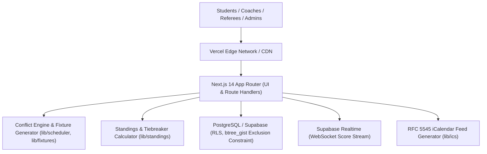

# IU SPORTS HUB — Technical Architecture Document

## 1. System Overview
**IU Sports Hub** is a 3-tier, serverless-friendly web platform engineered for Iqra University Islamabad. It streamlines campus sports management by replacing manual, paper/WhatsApp-driven coordination with an automated, conflict-free system.



## 2. Core Scheduling & Conflict-Prevention Engine
The platform solves university sports clashes through a two-layer verification architecture:

### 2.1 Database-Level Invariant (PostgreSQL btree_gist)
Venues cannot be double-booked at the database layer via exclusion constraints:
```sql
alter table matches add constraint no_venue_overlap
  exclude using gist (
    venue_id with =,
    tstzrange(starts_at, ends_at) with &&
  ) where (status not in ('cancelled','postponed'));
```

### 2.2 Application-Level Greedily Constrained Solver (`src/lib/scheduler.ts`)
Validates 6 critical dimensions before any match is scheduled or rescheduled:
1. **Venue Operating Hours:** Ensures matches start and finish within facility opening and closing times (e.g. 08:00 - 20:00).
2. **Venue Double-Booking:** Cross-checks active matches across the same venue.
3. **Team Double-Booking:** Prevents either team from playing across different venues at overlapping times.
4. **Academic Blackout Hours:** Enforces university blackout windows (e.g. Mon-Fri 09:00 - 13:00) so sporting events do not interfere with class schedules.
5. **Venue Maintenance Blocks:** Prevents scheduling during scheduled maintenance periods.
6. **Minimum Rest Hours:** Enforces minimum recovery periods between matches for athletes.

## 3. Fixture Generation Logic (`src/lib/fixtures.ts`)
- **Round-Robin (Circle Method):** Generates $N-1$ rounds for $N$ teams, handling odd team counts by introducing and pruning dummy BYEs.
- **Single Elimination Knockout:** Pads bracket to powers of 2 ($2^k$) with seeded pairings and top-seed byes.
- **Group + Knockout:** Snake-draft seeding into balanced groups with intra-group round-robin fixtures advancing top seeds.

## 4. Standings & Points Calculation (`src/lib/standings.ts`)
- Real-time aggregation of matches played, won, drawn, lost, goals for, goals against, and goal difference.
- Tie-breaking hierarchy: **Points $\rightarrow$ Goal Difference $\rightarrow$ Goals For $\rightarrow$ Head-to-Head $\rightarrow$ Alphabetical**.
